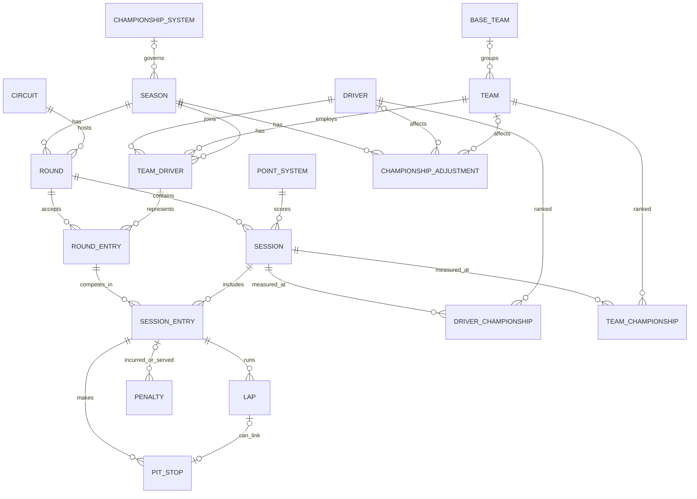
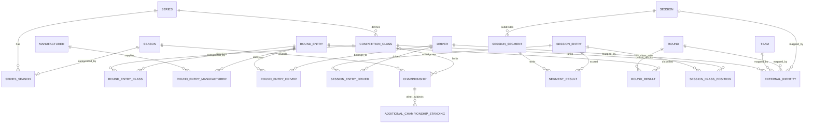

# OpenGP — Canonical Data Model v5 (Recommended, Founder Review)

> **Status:** PROPOSED — not Founder-approved, not implemented.  
> **Source of truth:** Jolpica-F1 Django models for the original 18 entities; OpenGP `docs/data-providers.md` for the 18 target series.  
> **Principles:** (1) retain all 18 Jolpica entities and their exact original fields; (2) do not add synonyms/duplicate tables merely for generic names; (3) introduce additive entities only when an actual multi-series relationship or fact cannot be represented; (4) *canonical logical data model* ≠ verbatim deployment of Jolpica's Django database constraints.  
> **Date:** 2026-10-30. No GitHub changes made.

## 1. Executive decision

**Retain Jolpica's 18 entities intact as a compatibility baseline, then add narrow cross-series extensions.** Keep `Round`, `Driver`, `TeamDriver`, `RoundEntry`, `SessionEntry`, `Circuit`, `PointSystem`, `ChampionshipSystem`, `ChampionshipAdjustment`, `DriverChampionship`, and `TeamChampionship` names. In particular, **do not add `Venue` as an alias for `Circuit`, and do not add `ResultSet` / `ClassificationRow` as a second copy of the existing `SessionEntry` classification**.

**Critical qualification:** literal, unchanged Django schema constraints are *not* a workable shared 18-series database. This document preserves original **entity field contracts**, **not** the proposition that all upstream constraints can be reused unchanged in one physical database. See Section 5. In the F1 adapter, original shapes can remain identical. In the OpenGP canonical application layer, additional metadata and normalized views can be used without editing original fields.

## 2. Original Jolpica-F1 18 entities: preserved, zero field changes

### 2.1 Entities and semantics — original fields

The field names below reproduce the model's declared direct fields / explicitly declared many-to-many relationships (not implicit reverse accessors). FK types, nullability and uniqueness continue to be defined by the Jolpica upstream source; this table does not override them.

| Jolpica Entity | Original fields (unchanged) | Plain-English / 中文 meaning |
| --- | --- | --- |
| `Season` | `id`, `teams`, `drivers`, `championship_system`, `api_id`, `year`, `wikipedia` | One F1 season / 一届赛季 |
| `Round` | `id`, `season`, `circuit`, `team_drivers`, `api_id`, `number`, `name`, `date`, `race_number`, `wikipedia`, `is_cancelled` | One round / 一站比赛 |
| `Session` | `id`, `round`, `number`, `point_system`, `round_entries`, `api_id`, `type`, `timestamp`, `has_time_data`, `timezone`, `scheduled_laps`, `completed_laps`, `completed_distance`, `is_cancelled` | Practice, qualifying, race etc. / 单个比赛环节 |
| `Circuit` | `id`, `api_id`, `reference`, `name`, `locality`, `country`, `country_code`, `latitude`, `longitude`, `altitude`, `wikipedia` | Competition circuit/location / 比赛场地实体（原字段保持不变） |
| `Driver` | `id`, `api_id`, `reference`, `forename`, `surname`, `abbreviation`, `nationality`, `country_code`, `permanent_car_number`, `date_of_birth`, `wikipedia` | Driver identity; OpenGP may map rider/co-driver here in its adapter / 参赛人员身份 |
| `BaseTeam` | `id`, `api_id`, `name` | Underlying organization despite rebrands / 基础车队组织 |
| `Team` | `id`, `base_team`, `drivers`, `api_id`, `reference`, `name`, `nationality`, `country_code`, `wikipedia`, `primary_color` | Racing team/constructor / 车队 |
| `TeamDriver` | `id`, `team`, `driver`, `season`, `api_id`, `role` | Driver–team relationship in a season / 赛季车队归属 |
| `RoundEntry` | `id`, `round`, `team_driver`, `api_id`, `car_number` | Entry for a round / 本站参赛单位（原始字段以 TeamDriver 为锚点） |
| `SessionEntry` | `id`, `session`, `round_entry`, `api_id`, `position`, `is_classified`, `status`, `detail`, `points`, `is_eligible_for_points`, `grid`, `time`, `fastest_lap_rank`, `laps_completed`, `driver_of_the_day_percentage`, `driver_of_the_day_winner` | Participation **and** a session classification / 单场参赛及成绩 |
| `Lap` | `id`, `session_entry`, `api_id`, `number`, `position`, `time`, `average_speed`, `is_entry_fastest_lap`, `is_deleted` | One lap / 单圈 |
| `PitStop` | `id`, `session_entry`, `lap`, `api_id`, `number`, `duration`, `local_timestamp` | One pit stop / 一次进站 |
| `Penalty` | `id`, `earned`, `served`, `api_id`, `license_points`, `position`, `time`, `is_time_served_in_pit` | Incurred / served penalty / 比赛处罚 |
| `PointSystem` | `id`, `api_id`, `reference`, `name`, `driver_position_points`, `driver_fastest_lap`, `team_position_points`, `team_fastest_lap`, `partial`, `shared_drive`, `is_double_points` | Rules for awarding session points / 单场积分规则 |
| `ChampionshipSystem` | `id`, `api_id`, `reference`, `name`, `eligibility`, `driver_season_split`, `driver_best_results`, `team_season_split`, `team_best_results`, `team_points_per_session` | Season-wide points accounting / 全赛季计分制度 |
| `ChampionshipAdjustment` | `id`, `api_id`, `season`, `driver`, `team`, `adjustment`, `points` | Championship deduction/disqualification / 赛季级积分或资格调整 |
| `DriverChampionship` | `id`, `session`, `driver`, `year`, `round_number`, `session_number`, `position`, `points`, `win_count`, `highest_finish`, `is_eligible`, `adjustment_type`, `season`, `round` | Driver standings row as of a session / 车手积分榜中的单条记录 |
| `TeamChampionship` | `id`, `session`, `team`, `year`, `round_number`, `session_number`, `position`, `points`, `win_count`, `highest_finish`, `is_eligible`, `adjustment_type`, `season`, `round` | Team standings row as of a session / 车队积分榜中的单条记录 |

*The 18 upstream models are **not** reproduced as new OpenGP database tables in this recommendation. `DriverChampionship` and `TeamChampionship` remain original managed-view model concepts. Original enum/constraint definitions are untouched in this baseline.*

## 3. Additions justified by unique multi-series facts

These are proposed **logical** entities. A relation/link entity is justified by the no-field-changes rule; it is not a replacement for an original entity.

| New entity | Essential fields (proposed only) | Unique function / simple example | Need |
| --- | --- | --- | --- |
| `Series` | `id`, `name`, `category?` | The championship family: F1 vs WEC vs MotoGP / 不同赛事系列 | Core |
| `SeriesSeason` *(link + season display metadata)* | `seriesId`, `seasonId`, `label?`, `startAt?`, `endAt?` | Attach an unchanged `Season` to a `Series`; describe Formula E 2026/27 label / 赛季归属和跨年名称 | Core, but doesn't solve DB `year` uniqueness |
| `CompetitionClass` | `id`, `seriesId`, `name`, `code?` | WEC Hypercar versus LMGT3 / 不同参赛组别 | Core for mixed-class races |
| `RoundEntryClass` *(link)* | `roundEntryId`, `competitionClassId` | WEC car #7 is Hypercar / 参赛单位所属组别 | Needed when class exists |
| `Manufacturer` | `id`, `name` | Ducati as a manufacturer, versus Ducati Lenovo as a team / 制造商身份 | Needed for manufacturer championships |
| `RoundEntryManufacturer` *(link)* | `roundEntryId`, `manufacturerId` | Car belongs to a manufacturer without changing `RoundEntry` / 赛车的制造商 | Optional by provider |
| `RoundEntryDriver` *(link)* | `roundEntryId`, `driverId`, `role?` | WEC car #7 has three drivers; WRC has a co-driver / 一车多人 | Core for endurance/rally |
| `SessionEntryDriver` *(link)* | `sessionEntryId`, `driverId`, `role?` | FP1 substitute vs Race starter; who actually participates / 单场实际驾驶人员 | Conditional |
| `Championship` | `id`, `seasonId`, `name`, `subjectType`, `competitionClassId?` | *What title is being ranked?* e.g. WEC Hypercar Manufacturer title / 哪项锦标赛 | Core for series with several titles |
| `AdditionalChampionshipStanding` | `championshipId`, `subjectType`, `subjectId`, `asOfRoundId?`, `asOfSessionId?`, `rank?`, `points`, `wins?` | **Only** standings not expressible in unmodified Driver/Team views: manufacturer/owner or multiple class contexts / 额外积分榜条目 | Conditional; no double storage of F1 rows |
| `ExternalIdentity` | `entityType`, `canonicalId`, `provider`, `externalId`, `scope?`, `verifiedBy?` | Jolpica and OpenF1 IDs refer to the same driver/round/session / 外部 ID 映射 | Core integration |
| `SessionSegment` | `id`, `sessionId`, `kind`, `number?`, `startsAt?`, `endsAt?` | NASCAR Stage within a Race, IMSA mid-race checkpoint / 比赛内部计分分段 | Conditional |
| `SegmentResult` | `segmentId`, `sessionEntryId`, `rank?`, `points?` | Stage 1 standings and stage points without overwriting Race result / 分段结果 | Conditional |
| `RoundResult` | `roundId`, `roundEntryId`, `overallPosition?`, `classPosition?`, `classificationStatus?`, `elapsedMs?`, `points?` | WRC overall Rally classification is **not** a single Special Stage result / 整站累计成绩 | Conditional |
| `SessionClassPosition` | `sessionEntryId`, `competitionClassId`, `classPosition?` | IMSA entry P8 overall, P2 in GTD / 同场组别名次 | Conditional |

**No added `Venue`, `Person`, `Participant`, `Event`, `Entry`, `Standings`, `StandingRow`, `ResultSet`, `ClassificationRow`, `ScoringRule`, or `ChampionshipRules`.** They would rename, overlap with, or partially duplicate kept Jolpica concepts under the present design rule.

**`ResultPublication` is deliberately not a mandatory entity.** Treat `{availability, publicationStatus, provider, retrievedAt, sourceEndpoint, revision?}` as metadata at the normalized application-response boundary. Persistent version history can be added only when justified and when actual historical snapshots are retained. No claim that snapshot history exists today.

## 4. Proposed additive ERD (original 18 untouched)

This diagram shows extension relationships. It should be read **together with** the 18-entity diagram above.

`EXTERNAL_IDENTITY` is a polymorphic crosswalk: the four links above are examples, not the complete list. `ADDITIONAL_CHAMPIONSHIP_STANDING.subjectType/subjectId` is a typed subject reference, not separate nullable FKs. The `SeriesSeason` relationship is **exactly one series per OpenGP season** as a logical rule; the diagram does not relax original upstream uniqueness constraints.

## 5. Five unavoidable incompatibilities: don't conceal them

These findings are from Jolpica's actual Django models and must be solved in **OpenGP's logical adapter/persistence boundary** before claiming full 18-series support. Creating more junction entities **alone** does not fix them.

1. **`Season.year` globally `unique=True`.** 2026 F1 and 2026 WEC require separate Season objects of the same year. `SeriesSeason` doesn't remove the database uniqueness restriction. **Recommended:** leave Jolpica original untouched, but do **not** deploy its Season table unchanged as a shared OpenGP table. Use `seriesId`-scoped canonical identity and composite `(seriesId, season identity)` uniqueness in eventual native OpenGP storage. This is a future DB-design choice, **not** a change to the Jolpica field definition.
2. **`Round.circuit` required.** Rally routes and multi-location rounds may not have one traditional Circuit. **Recommended:** use the original Circuit when a truthful competition location/route is known; otherwise retain a partially mapped Round at the adapter boundary. Never fabricate a circuit or coordinates. If full persistence is mandated, the OpenGP-native persistence rule must differ (e.g. optional site relation), requiring an explicit exception to strict original DB constraints.
3. **`RoundEntry.team_driver` required.** Multiple actual drivers can be expressed via `RoundEntryDriver`, but that does not remove the mandatory original anchor. **Recommended:** populate it only when a trustworthy TeamDriver relation exists; do not invent a primary driver. If the source provides only an equal-status crew and no valid anchor, represent the incomplete canonical record outside literal original Django storage until a constrained persistence adaptation is approved.
4. **`Session.type` is an F1-specific enum and `point_system` is required.** A WRC Special Stage or NASCAR stage format cannot be accurately represented simply by forcing an F1 code or rule. **Recommended:** normalize source-specific session kinds in application metadata/adapter mapping; when implementing non-F1 persistent data, define an OpenGP-compatible storage representation without editing upstream source code. Unsupported cases must remain explicit rather than being labeled `R` incorrectly.
5. **Jolpica's `PointSystem`, `ChampionshipSystem`, and standings constraints are F1-oriented.** NASCAR Chase, WEC classes, MotoGP constructors and other subjects cannot all be calculated by the original choice enums and two original views. **Recommended:** preserve those original models for compatibility but treat externally published standings as the authority; use `Championship` and `AdditionalChampionshipStanding` for only the genuinely new subjects/contexts. Build a new rules engine only if later required.

**Architectural truth:** It is impossible to insist on *all three* of these simultaneously: (a) physically deploy every Jolpica Django constraint without modification; (b) put all 18 series into one relational schema without exceptions; and (c) avoid redundant/fake placeholder entities. The recommended compromise is to **keep original 18 entity field contracts intact as upstream-compatible definitions**, while treating the cross-series OpenGP model and future persistence layer as a separate implementation responsibility. This proposal does not claim complete validated support for all 18 series yet.

## 6. Implementation boundary and verification

**Conceptual model:** all 18 original entities + additions above can be represented in design documentation. **F1 v1 implementation:** only data supported by Jolpica/OpenF1, with capability-based routing, trusted classifications and exact provenance/availability. **Database:** independent later design, no one-table-per-entity obligation. **HTTP API Contract:** generated/validated against real NestJS DTOs/Controllers after canonical choices are approved.

Validation before approval: (1) F1 ordinary and substitute driver; (2) WEC three-driver car + two classes; (3) NASCAR segment points and owner/manufacturer standings; (4) WRC Rally overall vs stages + co-driver; (5) Formula E cross-year doubleheader; (6) MotoGP constructor vs team; (7) GTWC multiple classes. Other series need concrete provider fixtures before making full-coverage claims. Document `unsupported`, `partial`, `not_published`, and `upstream_error` separately.

**Source files verified:** `jolpica/jolpica-f1/jolpica/formula_one/models/*.py` and `managed_views/championship_standing.py`; OpenGP `docs/data-model.md` and `docs/data-providers.md`. No source file, schema, API or GitHub document was modified or tested as part of this architecture proposal.
