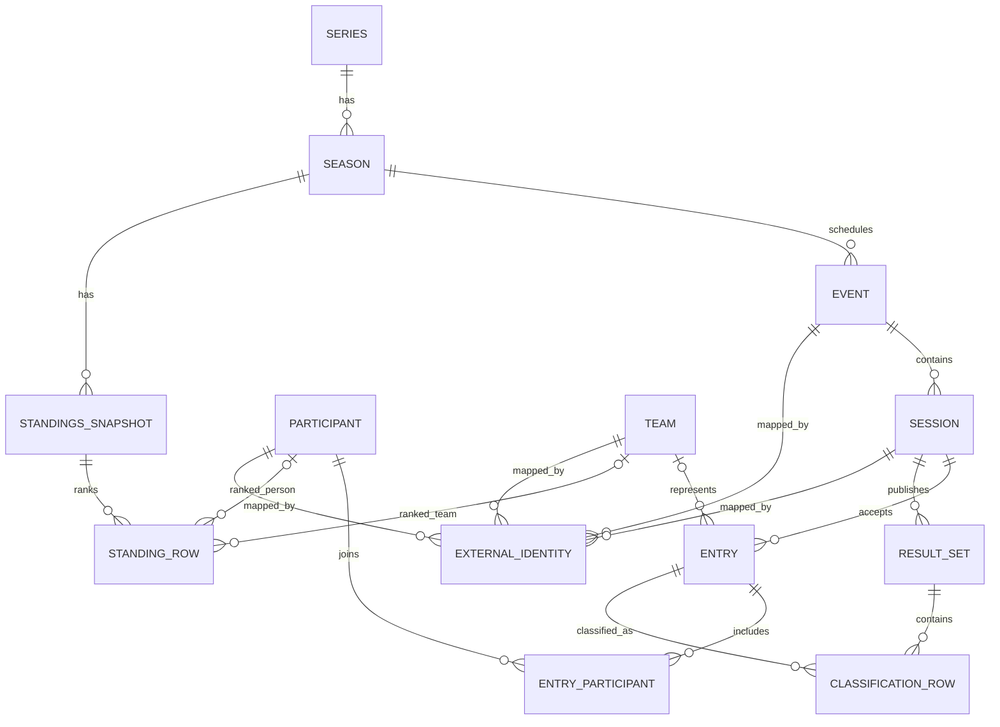

# OpenGP — Canonical Data Model v1

> **Status:** Multi-series semantic proposal; **W03 F1 subset implemented on the feature branch**, not deployed. Exact DTOs are in `backend/src/racing/model.ts`. **Updated:** 2026-10-30.
>
> **Authority:** This document defines the internal meaning and relationships of racing entities. HTTP routes and JSON responses are specified in [`api-contract.md`](./api-contract.md); supplier mappings in [`f1-data-providers.md`](./f1-data-providers.md). A canonical model does **not** require a database.

## W03 implementation boundary

The semantic proposal below is retained for future multi-series work. The
implemented [HTTP contract](./api-contract.md) determines actual v1 fields.

| Proposed concept | W03 F1 implementation |
| --- | --- |
| Global Participant / Team | F1 Driver / Constructor with external crosswalks; global cross-series identity deferred |
| EntryParticipant join entity | `Entry.participantIds[]`; shared-car result rows can identify the individual participant |
| Season nullable year | F1 seasons currently require a year; non-calendar seasons deferred |
| ResultSet publication | `published_unverified`; no provider-certified final status is asserted |
| Session lifecycle | `scheduled`, `started`, `suspended`, `finished`, `cancelled`, `unknown`; basis is explicit |
| Availability | Includes `unknown` for ambiguous historical empty results |
| StandingsSnapshot | Supplier `Standings` + source hash/retrieval time; latest or round-specific reads, no retained historical snapshot store |
| ExternalIdentity / Provenance | Embedded external IDs and envelope `meta.sources[]` |
| Persistence | Demand-driven in-process caches and bounded revision pointers; no durable sync |

Entries are materialized with published results. GP round/date changes preserve
the deterministic name-based Event ID; GP renames still need explicit aliases.
Known 1950 Britain shared cars are scoped mappings, not a universal heuristic.
See [W03 handoff](./w03-backend-handoff.md) for verification and remaining risks.

## 1. Model at a glance (multi-series proposal)

## 2. Entities and semantics

| Entity | Identity and essential fields | Meaning |
| --- | --- | --- |
| `Series` | `id`, `name`, `category` | Championship/competition (e.g. F1, WEC); not provider ID |
| `Season` | `id`, `seriesId`, `year`, `name` | Belongs to one series; `year` is nullable for non-calendar-year seasons |
| `Event` | `id`, `seasonId`, `name`, `roundNumber?`, `venue?`, `startsAt?`, `endsAt?` | Weekend/round; not a session |
| `Session` | `id`, `eventId`, `type`, `name`, `scheduledStartAt?`, `scheduledEndAt?`, `actualEndAt?`, `lifecycle` | Practice/qualifying/sprint/race; independent timing and cancellation state |
| `Participant` | `id`, `displayName`, `kind`, `birthDate?`, `nationality?` | Person (driver/rider); global identity shared across series |
| `Team` | `id`, `name` | Organization; team branding/name can change by season |
| `Entry` | `id`, `sessionId`, `number?`, `teamId?` | One competing entry in a particular session; a car may involve multiple people |
| `EntryParticipant` | `entryId`, `participantId`, `role?` | Many-to-many; protects WEC/IMSA shared-car semantics |
| `ResultSet` | `id`, `sessionId`, `kind`, `publicationStatus`, `publishedAt?`, `revision?` | Published snapshot; separate from session lifecycle |
| `ClassificationRow` | `resultSetId`, `entryId`, `position?`, `positionText?`, `classificationStatus`, `laps?`, `points?`, `elapsedMs?`, `gapMs?`, `bestLapMs?` | Classification; position and status independent |
| `StandingsSnapshot` | `id`, `seasonId`, `type`, `asOfEventId?`, `asOfSessionId?`, `publicationStatus`, `retrievedAt` | Published drivers/teams points as-of a point in the season |
| `StandingRow` | `snapshotId`, `participantId?`, `teamId?`, `rank?`, `points`, `wins?` | Exactly one competitor reference; can reflect adjustments |
| `ExternalIdentity` | `entityType`, `canonicalId`, `provider`, `externalId`, `scope?`, `verifiedBy?` | Alias/crosswalk across Jolpica, OpenF1 and later providers |
| `Provenance` | `provider`, `sourceEndpoint?`, `retrievedAt`, `coverage?` | Source of a value or aggregate; can be attached to a result or response |

Fields here are semantic guidance, **not yet exact TypeScript DTOs**. A `?` marks optional/nullable values. Stable ID policy must be deterministic across refreshes; do not expose ephemeral upstream keys as canonical IDs. Keep legacy aliases for existing `openf1-session-*` URLs.

## 3. Required distinctions

- `Entry` is not `Participant`: WEC entries may have multiple drivers; historical F1 can have shared cars.
- A position is not a finish status: DSQ/DNF/DNS/NC may require separate status even if `position` is supplied. Preserve upstream `positionText` and `status` for interpretation; don't infer classifications from lap rankings.
- `Session.lifecycle`: `scheduled | running | finished | cancelled | unknown`. This is **not** result publication state.
- `ResultSet.publicationStatus`: `unknown | provisional | final`. Provider-returned results are **not proof** they are officially final.
- `Availability`: `available | partial | not_published | unsupported | upstream_error | access_restricted | not_applicable`. Missing results are not an empty classification.
- `points` are decimal (half-points exist); store/expose exact decimal strings when serialized, e.g. `"12.5"`.
- All times are ISO 8601 UTC instants when known. Scheduled end is not actual end. Race time is not always gap-to-leader.
- A season championship standings snapshot is not equivalent to summing all race rows; source standings can contain adjustments.
- Person matching: verified common IDs or supported multi-attribute evidence; **do not merge by name or number alone**. Ambiguous matches stay separate until reviewed.
- External identifiers need a namespace and context: provider + entity type + external ID; include season/session scope if the provider ID is not globally unique.

## 4. F1 source responsibilities

Jolpica is primary for seasons, rounds, schedule, race/qualifying/sprint classifications and standings. OpenF1 supplements session keys, cancellations, practice and sprint qualifying results and timing/race control. F1DB is deferred offline historical material. See [`f1-data-providers.md`](./f1-data-providers.md) for endpoints, actual fields, coverage, sample validation and precedence rules.

## 5. Decisions to finalize before marking v1 approved

1. Exact ID generation/crosswalk strategy and persistence boundary; an in-memory-only alias registry cannot guarantee global stability in every case.
2. Whether `Entry` persists for sessions before start and whether classification snapshots are stored or reconstructed on each request.
3. Multi-series team identity policy (same legal organization versus event-specific entrant/team name).
4. Actual result `final` provenance and revision retention; providers do not universally certify FIA final status.
5. Which proposed entities are required now versus deferred without losing future compatibility.

**Persistence:** A database schema remains optional future design; no database or schema deployment is part of W03.
