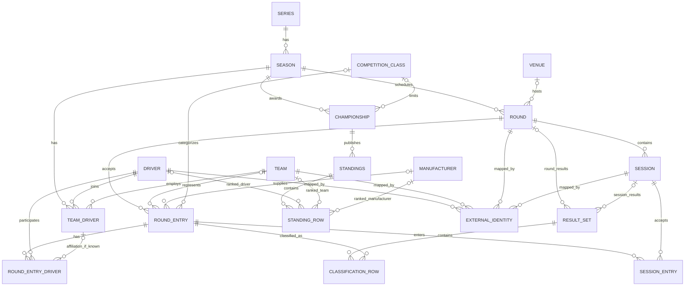

# OpenGP — Canonical Data Model v2 (Discussion Draft)

> **Status:** Proposed for Founder review; not approved or implemented. This is a logical model, not a database schema or API contract. Based on the existing `docs/data-model.md` v1 and discussions through 2026-10-30. No changes made to GitHub.

## 1. Model at a glance

**Reading rules:**
- `Round` is one trackable competition unit within a season; `roundNumber` is optional. One weekend can contain multiple Rounds (e.g. doubleheader). `Session` is a practice, qualifying, race, stage, etc.
- `RoundEntry` is an entrant/car/competition unit **at Round level**; `RoundEntryDriver` is its driver/rider/co-driver roster. `TeamDriver` is a driver–team–season affiliation, which can be unknown and is not a prerequisite for joining a RoundEntry.
- `SessionEntry` says which RoundEntry participates in which Session. Actual drivers in an individual Session can differ from the Round roster; represent `actualDriverIds?` when supported, or add a SessionEntry–Driver relation if finer granularity becomes necessary.
- A `ResultSet` belongs to **exactly one** of `Round` or `Session` (`roundId XOR sessionId`); both optional-looking ERD edges reflect polymorphic ownership, not permission to leave both blank or populate both.
- `ClassificationRow` refers to a `RoundEntry`, whether the result is Round-level or Session-level. It is separate from participation and can be revised.
- A `StandingRow` identifies **exactly one** ranking subject (`driver`, `team`, `manufacturer`; more types can be added), rather than all three.
- `ExternalIdentity` is a polymorphic crosswalk; ERD shows representative entity types, not its complete set. Provider keys must be scoped and safely verified. `Manufacturer` is a logical identity to support where known; a separate database table is not mandatory now.
- `Provenance` is modeled as metadata attached to source-backed data, not necessarily a standalone entity/table.

## 2. Entities and semantics

| Entity | Identity and essential fields | Meaning |
| --- | --- | --- |
| `Series` | `id`, `name`, `category?` | A racing series, e.g. F1, WEC, MotoGP; independent of Provider IDs. |
| `Season` | `id`, `seriesId`, `name`, `year?`, `startYear?`, `endYear?` | A season under a Series, including cross-year seasons such as 2025/26. |
| `Round` | `id`, `seasonId`, `name`, `roundNumber?`, `venueId?`, `startsAt?`, `endsAt?`, `status?` | A trackable competition unit, e.g. Chinese GP, Rally Monte-Carlo or one Formula E doubleheader race. No mandatory official round number. |
| `Session` | `id`, `roundId`, `type`, `name`, `scheduledStartAt?`, `scheduledEndAt?`, `actualEndAt?`, `lifecycle` | Practice, Qualifying, Sprint, Race, Special Stage, etc.; session timing/status is separate from result publication. |
| `Venue` | `id`, `name`, `type?`, `locality?`, `country?`, `latitude?`, `longitude?`, `timezone?` | Where the Round takes place (circuit or other venue/area). More detailed stage/course locations can be added later. |
| `Driver` | `id`, `displayName`, `nationality?`, `birthDate?` | A real person participating as driver, rider or co-driver; role depends on their participation, not a permanent person type. |
| `Team` | `id`, `name`, `country?` | A racing team or entrant organization; not necessarily the manufacturer. |
| `TeamDriver` | `id`, `seasonId`, `teamId`, `driverId`, `role?` | A Driver’s relationship with a Team in a Season; does not imply attendance at every Round. |
| `CompetitionClass` | `id`, `seriesId?`, `seasonId?`, `name`, `code?` | A competing class, e.g. WEC Hypercar / LMGT3; class applicability may vary by season. |
| `Manufacturer` | `id`, `name` | Manufacturer/constructor identity, e.g. Ducati vs a specific MotoGP team. Logical support now; persistence may be deferred. |
| `RoundEntry` | `id`, `roundId`, `number?`, `teamId?`, `manufacturerId?`, `competitionClassId?` | One entered vehicle/crew/competition unit at a Round, e.g. one WEC car with three drivers. |
| `RoundEntryDriver` | `roundEntryId`, `driverId`, `role?`, `teamDriverId?` | Links one RoundEntry to one or multiple Drivers; optionally records a known TeamDriver affiliation. |
| `SessionEntry` | `id`, `sessionId`, `roundEntryId`, `participationStatus?`, `actualDriverIds?` | The RoundEntry's participation in a particular Session. The actual driver roster may differ from the Round's overall roster. |
| `ResultSet` | `id`, `roundId?`, `sessionId?`, `kind`, `publicationStatus`, `publishedAt?`, `revision?` | One published results collection, attached to exactly one Round or Session; can represent revised results. |
| `ClassificationRow` | `resultSetId`, `roundEntryId`, `overallPosition?`, `classPosition?`, `positionText?`, `classificationStatus`, `laps?`, `points?`, `elapsedMs?`, `gapMs?`, `bestLapMs?` | One entrant's result within a ResultSet; results, finish status, and overall/class positions are distinct. |
| `Championship` | `id`, `seasonId`, `name`, `subjectType`, `competitionClassId?` | A distinct title contested in a Season, e.g. F1 Drivers' or MotoGP Constructors' Championship. |
| `Standings` | `id`, `championshipId`, `asOfRoundId?`, `asOfSessionId?`, `publicationStatus`, `retrievedAt` | A provider-published standings table at a specified point in the season, not necessarily calculated by OpenGP. |
| `StandingRow` | `standingsId`, `subjectType`, `subjectId`, `rank?`, `points`, `wins?` | One ranked Driver, Team, Manufacturer or supported future subject. Exactly one typed subject per row. |
| `ExternalIdentity` | `entityType`, `canonicalId`, `provider`, `externalId`, `scope?`, `verifiedBy?` | Maps external Provider identities onto OpenGP identities; never merge by name or car number alone. |
| `Provenance` *(metadata)* | `provider`, `sourceEndpoint?`, `retrievedAt`, `coverage?` | Where and when data came from; attach to results/standings/responses, not necessarily its own database table. |

Fields are **semantic guidance**, not finalized TypeScript DTOs. `?` means optional. Example IDs must be stable and not merely upstream temporary keys. `points` should serialize as decimal strings where exact values matter (e.g. `"12.5"`). `publicationStatus` must not be inferred as official `final` from Provider presence alone. `availability` (unpublished, unsupported, failed, etc.) must remain distinct from empty results.

### Deferred Jolpica-style extension modules (not part of the core ERD)

| Extension | Why deferred |
| --- | --- |
| `BaseTeam` | Team naming/lineage history, not required for early schedule/results. |
| `Lap`, `PitStop`, `Penalty` | Richer race details and penalties can be added by capability. |
| `PointSystem` | Required only if OpenGP calculates/scenarios session points itself; for v1 source the official standings from Providers. |
| `ChampionshipRules` | Required for self-calculated championship rankings across varying scoring eras/series. |
| `ChampionshipAdjustment` | Important for historical penalties and deductions; v1 should reflect Provider standings, not silently reconstruct them. |
| `SessionSegment` | Potential future NASCAR Stages, endurance checkpoints, or other explicit subdivisions, subject to Provider verification. |

## 3. Open questions before approval

1. Should `Round` mean an official round or a user-facing trackable unit when the two differ? This draft adopts the latter and keeps `roundNumber` optional.
2. Which external identities can remain stable without persistent mapping storage? Define canonical ID policy before coding public URLs.
3. How to represent Session-level driver substitutions using source-backed facts (optional `actualDriverIds` versus a separate normalized join).
4. How do `CompetitionClass` values and a championship's typed ranking subjects map to each series' actual Provider fields?
5. How to version and retain `ResultSet` revisions versus merely displaying the latest source data.

**Compatibility:** The current `docs/api-contract.md`, `database-schema.dbml`, and existing Backend TypeScript types still describe older designs. No automatic changes to those contracts are implied by this proposed Canonical Model.
