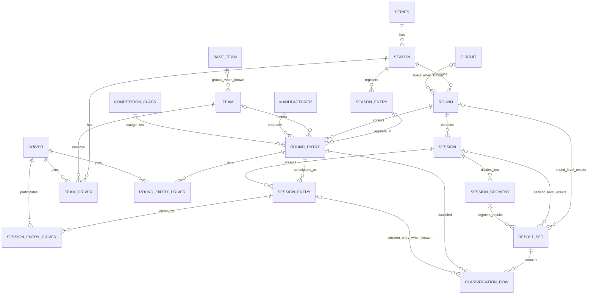
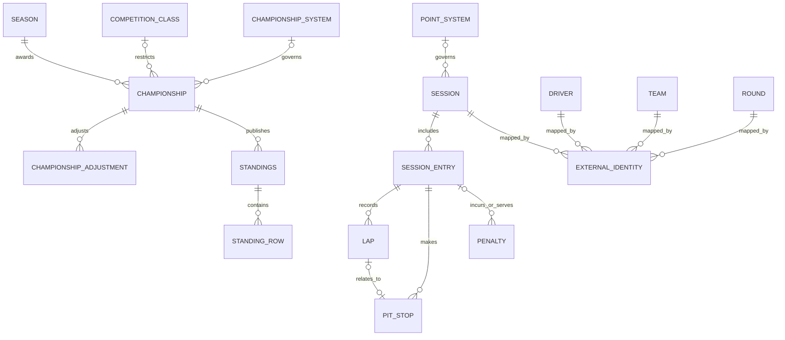

# OpenGP — Canonical Data Model (Final Recommended Design)

> **Status:** Engineering-ready recommended design / Founder approval pending. Not implemented; not a description of the current database or HTTP API.
>
> **Date:** 2026-10-30. **Scope:** 18 planned motorsport series, F1-first delivery. **Primary reference:** Jolpica-F1 Django models and OpenGP's prior `docs/data-model.md`, `docs/f1-data-providers.md`, `docs/data-providers.md`.
>
> **Important:** This document is the **normative proposed logical model**. All fields below are OpenGP canonical fields, **not** a claim that Jolpica has these same database fields. Jolpica source models remain untouched in its Provider adapter. A Canonical Entity is not necessarily a database table or public API resource.

## 1. Decisions and boundaries

1. `Series → Season → Round → Session` is OpenGP's primary motorsport hierarchy. **Round** is the canonical name; it is a trackable racing competition unit. `roundNumber` is optional. A double-header may create two Rounds with a shared `weekendKey`; shared Sessions are never duplicated with fake IDs.
2. Preserve readable racing terminology `Driver`, `Team`, `TeamDriver`, `RoundEntry`, `SessionEntry`, `Circuit`, `PointSystem`, `ChampionshipSystem`, `ChampionshipAdjustment`. `Driver` means a person participating as a driver, rider, or co-driver; **role lives on participation**.
3. Keep `BaseTeam`, `Lap`, `PitStop`, and `Penalty` in the logical model even if not implemented initially: each has independent racing meaning. No redundant `Venue` entity: `Circuit` is a reusable track/course identity where applicable; a Round can also carry a broader location label.
4. `Season` identity is `(seriesId, seasonKey)` rather than `year` globally unique. `seasonKey` handles cross-calendar-year seasons, e.g. `2025-26`; `year` can be the conventional start year when known.
5. `Round.circuitId` is **optional**. WRC Rally can have `locationLabel` without inventing a Circuit. A Stage may have its own `courseName` on Session; future route geometry is not part of core data.
6. `RoundEntry` is a **vehicle/crew/entrant in one Round**. It does not require a single `teamDriverId`. `RoundEntryDriver` permits one or more Drivers with roles; `SessionEntryDriver` records which of them actually drove/rode in a Session when known. `TeamDriver` retains its season-affiliation role and is optional as a source of lineup data.
7. `SeasonEntry` is an optional stable season-level entry (team/car/owner competition unit), distinct from a specific `RoundEntry`; supports NASCAR Owner rankings and stable endurance-car identities. **No duplicate `RoundEntry` rows just to represent a season registration.**
8. `SessionEntry` is **participation**, not the authoritative published classification. `ResultSet → ClassificationRow` is the only canonical published-results representation; upstream Jolpica `SessionEntry.position/points/...` maps into a `ClassificationRow`, never independently copied into a second mutable truth.
9. `ResultSet` belongs to **exactly one** scope: `round`, `session`, or `segment`; supports WRC overall Rally results, F1 Race results and NASCAR Stage results. One scope may expose multiple `kind` or revision variants.
10. Replace original Jolpica `DriverChampionship` and `TeamChampionship` canonical entities with a **single** `Championship → Standings → StandingRow` structure. They can still exist as source-specific adapters or derived views; do not create competing persistent totals.
11. `PointSystem` describes session-level award policy; `ChampionshipSystem` describes season/championship counting policy; `ChampionshipAdjustment` records exceptional changes. The model permits provider-sourced standings **without implementing a universal points calculator**.
12. `ExternalIdentity` maps provider IDs to canonical IDs with provider, entity type and scope. A name or vehicle number alone is never identity proof. `Provenance` and `Availability` are structured metadata, **not** extra top-level entities.
13. These definitions are independent from HTTP endpoints, NestJS DTOs and physical DB storage. Database schema must implement the semantic invariants without copying F1-only Jolpica constraints.

## 2. Model at a glance — complete Mermaid ERD

The visual is split into linked domains to remain readable. Together they cover all **29** canonical entities. Dotted links represent optional/typed associations; diagrams are conceptual, not executable SQL constraints.

### 2.1 Series, calendar, people, entrants and results

**`ResultSet` rule:** `scopeType + scopeId` selects exactly one of Round / Session / Segment; the three optional ERD edges do **not** mean three owners can be populated at once.

**Double-header rule:** `Round.weekendKey?` groups related Rounds for display. `Session.primaryRoundId` has one primary association, while `Session.additionalRoundIds?` may list other Rounds to which a genuinely shared Session applies. Do not create duplicate Session records when a single practice session is shared.

### 2.2 Rules, detailed timing, standings and cross-provider identity

`StandingRow.subject` is a typed reference to **one** of Driver, Team, Manufacturer or SeasonEntry. Rather than showing incorrect fixed Foreign Keys to all subjects in ERD, the contract is specified below.

## 3. Entities and semantics — complete definitions

`?` means optional. Every ID is an OpenGP canonical ID unless explicitly described as an upstream ID. `points` are exact decimal strings, not floating-point JSON numbers. Nonexistent/unknown values must stay null or unprovided.

### 3.1 Series, schedule and places — 5 entities

| Entity | Identity and essential fields | Meaning and example |
| --- | --- | --- |
| `Series` | `id`, `name`, `category?`, `status?` | A racing championship/series, e.g. `f1`, `wec`, `motogp`; not a Provider ID. |
| `Season` | `id`, `seriesId`, `seasonKey`, `name`, `year?`, `startDate?`, `endDate?` | A **series-specific** season; F1 2026 and WEC 2026 are separate records; `2025-26` is a valid seasonKey. |
| `Round` | `id`, `seasonId`, `name`, `roundNumber?`, `weekendKey?`, `circuitId?`, `locationLabel?`, `startsAt?`, `endsAt?`, `status` | A trackable racing round, e.g. Chinese GP, Rally Monte-Carlo, Formula E Tokyo Race 1; may not have a physical circuit or round number. |
| `Session` | `id`, `primaryRoundId`, `additionalRoundIds?`, `type`, `name`, `sequence?`, `scheduledStartAt?`, `scheduledEndAt?`, `actualStartAt?`, `actualEndAt?`, `timezone?`, `courseName?`, `pointSystemId?`, `lifecycle` | A timed sporting activity: Practice, Qualifying, Sprint, Race, Rally Special Stage, Heat, etc. May be relevant to multiple Rounds when a real session is shared. |
| `Circuit` | `id`, `name`, `locality?`, `country?`, `latitude?`, `longitude?`, `altitude?`, `layoutName?` | Reusable actual track/street course; Shanghai International Circuit. WRC Rally without one does **not** require a fake Circuit. |

### 3.2 People and organizations — 4 entities

| Entity | Identity and essential fields | Meaning and example |
| --- | --- | --- |
| `Driver` | `id`, `displayName`, `givenName?`, `familyName?`, `abbreviation?`, `nationality?`, `birthDate?`, `permanentNumber?` | A real person: F1 Driver, MotoGP Rider or WRC Co-driver. Their role is not permanently hard-coded on the person. |
| `Team` | `id`, `name`, `nationality?`, `baseTeamId?` | The entrant/team organization, e.g. McLaren or Ducati Lenovo Team. |
| `BaseTeam` | `id`, `name` | Optional known historical team lineage grouping across rebrands; no automatic merger on name similarity. |
| `TeamDriver` | `id`, `seasonId`, `teamId`, `driverId`, `role?` | Driver/team affiliation within a season. This does **not** establish attendance or actual driving in every Round. |

### 3.3 Season/round/session entries and classes — 8 entities

| Entity | Identity and essential fields | Meaning and example |
| --- | --- | --- |
| `SeasonEntry` | `id`, `seasonId`, `teamId?`, `manufacturerId?`, `competitionClassId?`, `number?`, `name?`, `ownerName?` | Optional season-long vehicle/entrant identity, e.g. a registered NASCAR #9 car or a WEC season entry. Not a single Round participation. |
| `RoundEntry` | `id`, `roundId`, `seasonEntryId?`, `teamId?`, `manufacturerId?`, `competitionClassId?`, `carNumber?`, `displayName?` | One car/crew/competition unit in a particular Round. **No required single `teamDriverId`.** |
| `RoundEntryDriver` | `roundEntryId`, `driverId`, `role`, `teamDriverId?` | The crew roster for the Round: one F1 driver, three WEC drivers, or WRC driver + co-driver. |
| `SessionEntry` | `id`, `sessionId`, `roundEntryId`, `participationStatus?` | A RoundEntry entered/present in a specific Session. **No authoritative position/points fields.** |
| `SessionEntryDriver` | `sessionEntryId`, `driverId`, `role?`, `participationDetail?` | Who actually drove/rode in this Session, when known. A session may have zero known drivers or multiple sequential drivers. |
| `CompetitionClass` | `id`, `seriesId`, `seasonId?`, `name`, `code?` | Class/division such as WEC Hypercar, LMGT3 or IMSA GTP. Do not conflate class with a Championship title. |
| `Manufacturer` | `id`, `name`, `country?` | Constructor/vehicle manufacturer identity, e.g. Ducati vs Ducati Lenovo Team. Different from Team. |
| `SessionSegment` | `id`, `sessionId`, `type`, `name`, `sequence?`, `startsAt?`, `endsAt?`, `distance?` | Subdivision of one Session, e.g. NASCAR Stage 1 or a timed IMSA checkpoint; not a duplicate Session. |

### 3.4 Results and race details — 5 entities

| Entity | Identity and essential fields | Meaning and example |
| --- | --- | --- |
| `ResultSet` | `id`, `scopeType`, `scopeId`, `kind`, `competitionClassId?`, `publicationStatus`, `publishedAt?`, `revision?` | A coherent published set of results: F1 Race, WRC entire Rally, NASCAR Stage, Qualifying, etc. Source-backed status does not automatically mean officially final. |
| `ClassificationRow` | `id`, `resultSetId`, `roundEntryId`, `sessionEntryId?`, `overallPosition?`, `classPosition?`, `positionText?`, `classificationStatus`, `laps?`, `points?`, `elapsedMs?`, `gapMs?`, `bestLapMs?`, `detail?` | One entrant's classification within that ResultSet; DSQ/DNF/DNS and overall/class ranks stay separate. |
| `Lap` | `id`, `sessionEntryId`, `lapNumber`, `position?`, `timeMs?`, `averageSpeed?`, `isEntryFastestLap?`, `isDeleted?` | A driven lap, e.g. Norris lap 15. Can carry a WRC stage split only through future specialized data, not by inventing laps. |
| `PitStop` | `id`, `sessionEntryId`, `lapId?`, `sequence?`, `durationMs?`, `timestamp?` | A pit service occurrence; no fictitious stops for racing formats without pit service. |
| `Penalty` | `id`, `earnedSessionEntryId?`, `servedSessionEntryId?`, `type`, `timeMs?`, `gridPlaces?`, `licensePoints?`, `description?`, `status?` | Session-level sporting penalty. Championship-wide adjustments use `ChampionshipAdjustment`, not Penalty. |

### 3.5 Championship, rules and standings — 6 entities

| Entity | Identity and essential fields | Meaning and example |
| --- | --- | --- |
| `Championship` | `id`, `seasonId`, `name`, `subjectType`, `competitionClassId?`, `championshipSystemId?` | A specific title: F1 Drivers, WEC Hypercar Manufacturers, MotoGP Constructors, NASCAR Owner or WRC Co-drivers. |
| `Standings` | `id`, `championshipId`, `asOfRoundId?`, `asOfSessionId?`, `asOfSegmentId?`, `publicationStatus`, `retrievedAt`, `revision?` | A provider-published ranking at a point in the season; may be reconstructed on demand rather than stored. |
| `StandingRow` | `id`, `standingsId`, `subjectType`, `subjectId`, `rank?`, `points`, `wins?`, `eligibility?`, `detail?` | A single ranked Driver, Team, Manufacturer or SeasonEntry. `subjectType + subjectId` resolves **exactly one** known subject. |
| `PointSystem` | `id`, `name`, `rulesVersion?`, `rulesConfig?` | Award policy for a Session or Segment, e.g. F1 race points or NASCAR Stage points. Specific rule schema can vary by Series. |
| `ChampionshipSystem` | `id`, `name`, `rulesVersion?`, `rulesConfig?` | Overall championship counting/eligibility policy, e.g. best-results, season reset, eligibility, adjustments. An optional description of provider rules, not a promise of self-calculation. |
| `ChampionshipAdjustment` | `id`, `championshipId`, `subjectType`, `subjectId`, `type`, `pointsDelta?`, `effectiveAt?`, `reason?` | Deduction, disqualification or exclusion affecting a specific championship. Explicitly separate from race finishing results. |

### 3.6 Data integration — 1 entity

| Entity | Identity and essential fields | Meaning and example |
| --- | --- | --- |
| `ExternalIdentity` | `entityType`, `canonicalId`, `provider`, `externalId`, `scope?`, `matchMethod?`, `verifiedAt?` | Crosswalk between OpenGP IDs and upstream IDs, e.g. Jolpica `driverId=norris` and properly scoped OpenF1 session car #4. Names/numbers alone are insufficient to merge identities. |

**Count:** 5 + 4 + 8 + 5 + 6 + 1 = **29** logical entities.

**Structured metadata (not separate entities):** `Provenance {provider, sourceEndpoint?, retrievedAt, rawIdentity?, confidence?}`; `Availability {status, reason?, checkedAt?}`; `SourceAttribution {provider, termsRef?}` where needed. Attach to source-backed aggregates or HTTP response metadata, not to every primitive column by default.

## 4. Canonical rules and exact invariants

### 4.1 Identity and relationships

- `Series.id` is unique. `(Season.seriesId, Season.seasonKey)` unique. **Never globally unique `Season.year`.**
- `Round.seasonId` required; `Round.roundNumber` nullable. When populated, a duplicate official `roundNumber` in a season is rejected **unless** the source uses multiple official competition instances sharing an ordinal, in which case a distinct scoped round key is required. Display title is not identity.
- `Round.circuitId` nullable; no fake Circuit for WRC. `Session.primaryRoundId` required. Additional related rounds may be recorded without creating duplicate Sessions; resolution to proper DB join is deferred to the DB-schema step.
- `TeamDriver` joins exactly one Driver, one Team and one Season when a verified affiliation exists. `RoundEntry` need not have a TeamDriver. `RoundEntry.teamId` nullable when no reliable team identity is known.
- `RoundEntryDriver` and `SessionEntryDriver` require distinct role values (`driver`, `rider`, `co_driver`, etc.); `driverId` always points to `Driver`. Multiple drivers per vehicle permitted; ordering alone does not create a special primary person.
- `SeasonEntry` is optional. If `RoundEntry.seasonEntryId` exists, its Season must equal `Round.seasonId` and any linked class/organization conflicts must be resolved explicitly, not silently.
- `SessionEntry.sessionId` must reference a Session applicable to the Round of its RoundEntry; if a Session is shared across two Rounds, use its scope mapping, not arbitrary cross-Round references.
- `ResultSet.scopeType ∈ {round,session,segment}` and `scopeId` references exactly one matching entity. A `ClassificationRow.roundEntryId` must refer to a participant appropriate to the ResultSet scope. A `sessionEntryId` is optional but, if present, must map to the same RoundEntry and applicable Session.
- `Championship.subjectType ∈ {driver,team,manufacturer,season_entry}`; official display can say 'rider', 'co-driver', 'owner', 'constructor' without inventing separate tables. `StandingRow.subjectType` must match championship subject type and point to a valid canonical subject.
- `Session.pointSystemId` may select a known scoring policy. The absence of a mapped PointSystem does not make published source results invalid. `Standings` may be as-of Round, Session, Segment or current; at most one `asOf*` pointer is populated.
- `ExternalIdentity` key = `(provider, entityType, externalId, normalizedScope)`. Unresolved or ambiguous matches are not silently unified. Canonical IDs are stable across refresh; provider transient session keys do not become permanent identity by themselves.

### 4.2 Results, time and availability

- `Session.lifecycle ∈ {scheduled,running,finished,cancelled,unknown}`. This is **not** result publication status.
- `ResultSet.publicationStatus` and `Standings.publicationStatus ∈ {unknown,provisional,final}`. `final` requires actual evidence, not merely a successful upstream response.
- `classificationStatus` must preserve the difference between finished, classified despite retirement, DNF, DNS, DSQ, DNQ, NC, unknown. Official provider detail fields should be retained; never infer official finishing position from fastest lap.
- `overallPosition` and `classPosition` are nullable separate ranks; classification status is independent. Do not turn a source sorting order for DSQ into an official finishing place.
- `points` / `pointsDelta` are exact decimal strings, e.g. `"12.5"`, not floating-point totals. Raw provider scoring should not be recomputed unless a matching rule engine is implemented and validated.
- Instants are UTC ISO 8601 when actually known; represent unknown times as `null`. `scheduledEndAt` is **not** `actualEndAt`. Time-zone context may be retained for display. A date-only event must not silently invent midnight as a true start time.
- `Availability.status ∈ {available,partial,not_published,unsupported,upstream_error,access_restricted,not_applicable}`. An upstream failure is not an empty classification. Preserve source retrieval timestamps and error provenance.
- `ResultSet.revision` is meaningful only if revision identity is known from upstream or retained by OpenGP. A logical ResultSet does **not** mean historical versions have been stored automatically.

### 4.3 Conflict avoidance

- **No `Venue`:** `Circuit` provides reusable named tracks when present; Round/Session may carry geographic labels for rally areas or unnamed routes. If geographic discovery later demands a broader location system, make that a separate automotive-events domain model.
- **No `DriverChampionship` / `TeamChampionship` canonical tables:** use derived driver/team standings views of generalized `Standings`. Do not calculate and store a second independent total.
- **No duplicate `SessionEntry` classification fields:** authoritative published result lives in `ClassificationRow`. Upstream Jolpica's original fields map there.
- **No `TeamMembership` / `Person`:** retained domain names `TeamDriver` / `Driver` with carefully documented semantics.
- **No mandatory universal scoring engine:** use official/provider standings when available, preserve point/championship rules and adjustments as model concepts for future enrichment.

## 5. Verification using representative cases

| Case | Required representation | Model outcome |
| --- | --- | --- |
| F1 Chinese GP / DSQ | Season → Round → Session; a published Race classification distinguishes DSQ from position; Jolpica + OpenF1 mapping | `ResultSet`, `ClassificationRow`, `ExternalIdentity` |
| F1 Practice / Sprint Qualifying | Source-specific OpenF1 Session results not present in Jolpica classification endpoints | Same canonical Session + ResultSet schema, capability-specific provider routing |
| Formula E Tokyo doubleheader | Two official Rounds in one weekend; a real shared practice session is not duplicated | Two Rounds, same `weekendKey`, Session applicable-round mapping |
| WEC / GT World Challenge | One car, multiple drivers; multiple racing classes; manufacturer not necessarily team | `RoundEntry`, `RoundEntryDriver`, `CompetitionClass`, `Manufacturer` |
| IMSA Michelin Endurance Cup | A Race has interim timed point checkpoints, separate from finish | `SessionSegment` + scoped results + dedicated `Championship` |
| WRC Rally | Driver + co-driver; Special Stage times and whole Rally final standings | Roles on `RoundEntryDriver`; Stage as Session; Rally `round`-scoped ResultSet; optional Circuit |
| NASCAR Cup / O'Reilly | Stage outcomes; Driver / Owner / Manufacturer standings | `SessionSegment`, `SeasonEntry`, typed `Championship` and `StandingRow` |
| MotoGP / Moto2 / WorldSBK | Riders, teams and constructors/manufacturers; Sprint or Superpole when available | Driver(role=rider), Team, Manufacturer, separate championships |
| F2 / IndyCar / Indy NXT / Super GT / GTWC regions | Typical calendar, qualification, race/heat; some multiple entry drivers/classes | Same canonical structures, no provider-specific fields imposed |

**Evidence level:** These are structural acceptance scenarios supported in representative cases by official event/standings formats; **not** a claim that all 18 upstream APIs have been field-by-field validated. Provider-specific mapping verification remains an integration task.

## 6. Jolpica-F1 migration map (all original 18)

| Jolpica Entity | OpenGP Canonical status | Reason |
| --- | --- | --- |
| `Season` | Keep / revise identity and constraints | `seriesId + seasonKey`, no global unique year |
| `Round` | Keep / loosen circuit requirement | WRC and special events may lack physical Circuit |
| `Session` | Keep / flexible types and time semantics | Stages, heats, segments, cancellations |
| `Circuit` | Keep | Reusable track/venue identity where appropriate |
| `Driver` | Keep | Driver/Rider/Co-driver unified person identity |
| `BaseTeam` | Keep | Known lineage/rebrands |
| `Team` | Keep | Team separate from Manufacturer |
| `TeamDriver` | Keep | Season-level affiliation, not Round entrant identity |
| `RoundEntry` | Keep / remove mandatory single TeamDriver | Multi-driver car/crew, optional season registration |
| `SessionEntry` | Keep / participation only | Published positions/points move to ClassificationRow |
| `Lap` | Keep | Future fine timing data |
| `PitStop` | Keep | Future race details |
| `Penalty` | Keep | Session-level infractions |
| `PointSystem` | Keep / broaden rules representation | Preserve F1 historical and series-specific points concepts |
| `ChampionshipSystem` | Keep / broaden rules representation | Championship policies/eligibility |
| `ChampionshipAdjustment` | Keep / type subject | Supports deductions and exclusions |
| `DriverChampionship` | **Replace as canonical entity** | Covered by `Championship + Standings + StandingRow` |
| `TeamChampionship` | **Replace as canonical entity** | Covered by same generalized standings model |

**Important boundary:** This is an OpenGP *canonical* remodel, not a change to Jolpica's upstream Django models. Provider DTOs must preserve their real fields; canonical adapters translate them. The OpenGP physical database (if adopted) must follow OpenGP's invariants, not blindly reuse Jolpica migrations.

## 7. Backend and database handoff — no blocking architecture decisions

### 7.1 Database Schema design next

- Use dedicated tables for stable master identities (`Series`, `Season`, `Round`, `Session`, `Driver`, `Team`, `ExternalIdentity`) **if** persistence is adopted; schema can defer tables for optional detail capabilities.
- Enforce unique `(series_id, season_key)`; preserve a stable canonical `id` namespace; normalize provider identity scope into a key suitable for uniqueness.
- `round.circuit_id NULL` allowed. Enforce `round_entry` has a unique internal ID, optional team/season entry and multiple drivers via join, not a required primary driver.
- Physically enforce ResultSet scope exactly-one using a `scope_type` plus typed FK strategy or separate nullable FKs + CHECK XOR. Pick one physical representation in DB phase; canonical semantics stay unchanged.
- For typed standings subjects, use declared subject references with validation or separate typed junctions to preserve referential integrity. Avoid a string-only `subjectId` column without integrity enforcement if using a relational DB.
- `Session.additionalRoundIds` requires a separate join relation in a normalized DB. It is a **field representation**, not a required new logical business entity.
- `Provenance`/`Availability` can be embedded with query responses and caches. Do not force one relational table per metadata concept.

### 7.2 HTTP API Contract next

- Start from current 6 OpenGP endpoints and preserve behavior until explicit versioned migration. Do not treat this conceptual model as existing public JSON.
- Define `/series`, `/seasons`, `/rounds`, `/sessions`, scoped `/results`, `/championships`, `/standings` as resources in a proposed versioned contract; exact paths decided in API design, **not** by this model.
- Include availability metadata, source attribution, complete/partial classification, and provider-safe errors. Preserve legacy `openf1-session-*` identity aliases during migration.
- Return consistently typed participant/entry display information but do not require all 29 entities in every response.

### 7.3 Required acceptance fixtures before marking implementation verified

1. Same `year` for F1, WEC, MotoGP creates three distinct Seasons.
2. WRC Round without Circuit and with driver/co-driver and Stage results maps without fake IDs.
3. WEC car with three drivers maps as one RoundEntry with three RoundEntryDriver links.
4. Formula E shared weekend Sessions map once and are discoverable from both relevant Rounds where applicable.
5. NASCAR Stage points and Owner standings do not become Race finishing positions or generic team standings by accident.
6. F1 Chinese GP DSQ / historic partial points preserve classification status, exact points, and provider provenance.
7. External IDs from two sources map without merging by same number or same name alone.
8. Missing, unpublished and upstream-error results are distinguishable.

**Design acceptance:** The canonical logical model is complete enough for a Database Schema design exercise and an F1 implementation plan. It is **not yet an assertion of all-provider data coverage, persisted schema existence or passing tests**. Founder approval is the only pending product-level signoff; there are no unresolved core logical entity choices intentionally left in this design.

## 8. References used

- OpenGP repository: https://github.com/zhangxijing97/opengp (`docs/data-model.md`, `docs/data-providers.md`, `docs/f1-data-providers.md`, `docs/architecture.md`, as inspected 2026-10-30).
- Jolpica Django models: https://github.com/jolpica/jolpica-f1/tree/main/jolpica/formula_one/models
- WEC driver classes: https://www.fiawec.com/en/page/regulations/18
- WEC manufacturer standings: https://www.fiawec.com/en/page/manufacturers-classification/34
- Official WRC event results / driver and co-driver: https://www.wrc.com/en/events/wrc-rally-chile-bio-bio-2026/wrc-rally-chile-biobio-results-2026
- Official NASCAR owner/manufacturer and Stage standings: https://www.nascar.com/standings/nascar-cup-series/
- Official IMSA interim Endurance Cup points: https://www.imsa.com/imsa-michelin-endurance-cup/
- Official Formula E doubleheaders: https://www.fiaformulae.com/en/news/races/formula-e-calendar-promos
- MotoGP Riders/Teams/Constructors distinctions: https://www.motogp.com/en/world-standing/2026/motogp/constructor-standings
